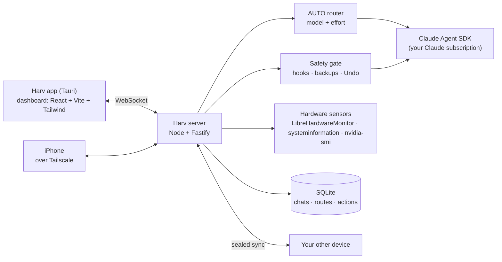

<div align="center">

# `[HARV]`

**A personal, Jarvis-style AI assistant for your computers: a live dashboard app, powered by Claude.**


</div>

---

Harv lives in a desktop app on your PC and your notebook, and on your phone. You type (or say) what you want into one command line and Harv does it: answer, read and change your files, write code in your projects, check what's slowing your PC down, make pictures, switch your lights. Meanwhile you watch your hardware and your Claude plan usage tick live beside the chat.

## ✦ Features

**Chat**

| | |
|---|---|
| **Command line chat** | One `harv>` prompt with streaming replies and a Claude Code-style status line (`✻ thinking… (12s · ↓ 340 tokens · esc to stop)`), folded `✻ thought for 12s` lines |
| **Works like Claude Code** | Claude Code's full toolset and your skills, plugins and connectors in every chat; messages queue while Harv is busy (*Send now*, take one back to edit), `/` commands with a menu, `/btw` side questions mid-reply, `/plan` mode, `/clear`, `/fresh`, `/report` |
| **Rich replies** | Markdown with highlighted code, math and Mermaid; pictures and file cards for files a reply names; a side pane that previews HTML, SVG, PDFs and Markdown live |
| **Cards** | Questions and plans from Harv come as cards you answer in place |
| **Rewind** | ⟲ on any of your messages puts the chat *and* the files back to that point |
| **Chat tabs** | Several conversations at once, Chrome-style: drag to reorder, they name themselves, and they can hand work to each other |
| **Files, terminal, browser per chat** | A file explorer (Windows 11 or Dolphin style), a terminal Harv can type into while you watch, and a real browser view Harv can drive |
| **Project mode** | Bind a chat to a project folder and Harv works like Claude Code there; new projects get a folder, git and a GitHub repo |
| **Attachments** | Drop in or paste files, or attach files and folders by path (`@` in the prompt) |
| **Scheduled tasks** | "Every morning at 8…": Harv runs it in that chat, even after a restart |
| **Pictures** | `generate_image` through the Gemini website in Harv's own browser profile |
| **Skills** | Reviewed skills (debugging, research, docs lookup, design polish…) that Harv picks by itself when a task fits |

**Harv itself**

| | |
|---|---|
| **AUTO router** | Picks the **model and effort** for each task (Haiku → Sonnet → Opus, low → max), tags every reply `[model·effort]`, steps up by itself when a reply struggles, and has a *Try harder* button |
| **Memory & persona** | One rulebook ([`harv/persona.md`](harv/persona.md)) shared by every chat, plus a private memory about you that stays on your devices |
| **Plan usage** | Claude session and weekly usage with reset times and warnings. At the limit Harv pauses, queues your messages and continues after the reset |
| **Safety gate** | Every action is green / yellow / red / blocked, with backups, optional approval cards, Undo, an action log and a stop button |
| **Settings** | Look (accent, glass, frost, zoom, photo / see-through / plain background, motion), chat, usage warnings, safety rules, startup, devices, sync, phone |

**Your computers**

| | |
|---|---|
| **Harv app** | A frameless Tauri app with a tray icon, `Ctrl+Alt+H`, notifications and "open when I log in"; on Linux, Harv can also start at boot |
| **Live hardware** | CPU (per thread), GPU, RAM, disks, network, temperatures, fans, clocks, power and top processes. The panel starts narrow and expands for full detail |
| **PC watchdog** | Quiet alerts for overheating, background CPU/GPU hogs, Defender detections, known miners and programs running from Temp |
| **Several devices** | The PC and the notebook each run a full Harv and stay in sync: chats, memory, settings, open tabs, drafts, files and projects, live over Tailscale and through an encrypted private Git repo |
| **Phone** | Harv on the iPhone over Tailscale (never the internet): pairing, Face ID, notifications, voice mode, Siri and the share sheet |
| **Lights** | Your Tapo light strip, by chat or automatically: on when it's dark and you're at the PC, off when you leave |

## ✦ Look: *Mission Control Glass*

A terminal soul in a frosted-glass body: IBM Plex Mono, ice-blue accents and frosted panels over a blurred photo of your choice (or a see-through window). Motion is subtle and can be switched off.

## ✦ How it works



- **Runs entirely on your Claude subscription** through the official Claude Agent SDK and Claude Code login. No API key, no extra billing. Harv strips API credentials from its own environment so it *can't* fall back to paid usage, and at a limit it waits for the reset.
- **Local only.** The server listens on `127.0.0.1`; the only exceptions are inside your own Tailscale network (live sync, the phone). Your data, backups and background live in `~/.harv`.
- **Personal use.** Harv is built for one person on their own machines, in line with Anthropic's terms for subscription use.

## ✦ The safety gate

| Level | Examples | What Harv does |
|---|---|---|
| 🟢 Green | read stats or files, search, open apps | Just does it |
| 🟡 Yellow | edit or move your files | Backs up first, does it, verifies, offers **Undo** |
| 🔴 Red | delete, install, kill processes, scripts, registry, sending things | Backs up and logs; with *Ask before risky actions* on, a safety check + preview → **asks you** → runs → verifies |
| ⛔ Blocked | format drives, touch `C:\Windows`, disable antivirus, read stored credentials | Refuses |

Approval cards offer **Approve all for this reply** and **Don't ask again** (saved as a rule you can remove in Settings). Read-only commands never need a card, and project chats ask only for the risky kinds. The gate is built from Agent SDK hooks, not prompt instructions, so Harv can't talk its way around it.

## ✦ Roadmap

- [x] **M0–M8**: glass dashboard, live hardware, chat on the subscription, tabs + history + memory, attachments, safety gate, AUTO router, usage meter, settings
- [x] **Extras**: project mode, files and terminal per chat, PC watchdog, Claude Code-style chats, previews, cards, rewind, scheduled tasks, pictures, a shared browser
- [x] **M9**: the Harv desktop app (Tauri)
- [x] **M10a–c**: Harv on Linux, Git sync and live sync between devices
- [x] **M11**: Harv on the phone (Siri, voice mode, push)
- [x] **M12**: the light strip and automatic lights
- [ ] **Next**: Harv's own skills (debug, deslop, ui-check, clone…), a better voice (local Whisper + Kokoro/Piper, Slovak, hands-free), start at boot on Windows, a home hub (M10d), desktop control, more apps

The full plan is in [`docs/PLAN.md`](docs/PLAN.md).

## ✦ Getting started

**Requirements:** Windows 11 or Linux (Fedora tested), [Node.js](https://nodejs.org) 24, and [Claude Code](https://code.claude.com) logged in with your Claude subscription. On Windows, recommended: [LibreHardwareMonitor](https://github.com/LibreHardwareMonitor/LibreHardwareMonitor) with its web server on `127.0.0.1:8085` (Options → Remote Web Server); it supplies temperatures, fans, power and drive health, and Harv starts it for you (one UAC prompt). The desktop app needs [Rust](https://rustup.rs).

```bash
npm install
npm run harv       # server on :4317, dashboard on http://127.0.0.1:5173
npm run app        # builds the Harv desktop app (apps/desktop)
```

`scripts/harv.ps1 start|stop|restart` (Windows) or `scripts/harv.sh` (Linux) runs Harv in the background (logs in `~/.harv/logs`); `scripts/install-shortcuts.ps1` / `.sh` adds the shortcuts and menu entry.

Background photo: pick one in Settings, or put an image at `~/.harv/background.jpg` (or `.png` / `.webp`).

| Command | What it does |
|---|---|
| `npm run harv` | Server + dashboard, the everyday way to run Harv |
| `npm run dev` | Server + dashboard, both with hot reload |
| `npm run app` | Build the desktop app |
| `npm test` | Unit tests (Vitest) |
| `npm run typecheck` | Type-check every workspace |
| `npm run lint` | ESLint |
| `npm run build` | Production build of the dashboard |

## ✦ Project layout

```
apps/server     Node + Fastify + WebSocket: agent, router, safety gate, sensors, usage, watchdog, sync, phone, devices
apps/web        React dashboard (Mission Control Glass)
apps/desktop    The Harv app (Tauri 2, Rust)
packages/shared Types shared by the server and the dashboard
harv/           Harv's rulebook (persona.md, dev-rules.md)
scripts/        Start/stop/restart, shortcuts, firewall rule, UI checks
docs/PLAN.md    Architecture, milestones, research notes
```

---

<div align="center">
<sub>Harv is an independent personal project, powered by Claude. Not affiliated with or endorsed by Anthropic.</sub>
</div>
