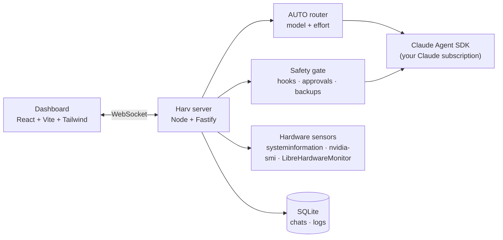

<div align="center">

# `[HARV]`

**A personal, Jarvis-style AI assistant for your PC: a live dashboard, powered by Claude.**


</div>

---

Harv lives in a dashboard in your browser. You type what you want into one command line and Harv does it: answer, read your files, check what's slowing your PC down, run tasks on your machine. Meanwhile you watch your hardware and your Claude plan usage tick live beside the chat.

## ✦ Features

| | |
|---|---|
| **Command line chat** | One `harv>` prompt with streaming replies and a Claude Code-style status line (`✻ thinking… (12s · ↓ 340 tokens · esc to stop)`) |
| **Works like Claude Code** | Messages queue while Harv is busy (with *Send now*), `/` commands and skills with a menu, `/btw` side questions answered mid-reply, `/clear` |
| **Chat tabs** | Several conversations at once, Chrome-style: drag to reorder, they name themselves, and they can hand work to each other |
| **Files & terminal per chat** | Each chat has its own Windows 11-style file explorer and a PowerShell terminal that survives restarts |
| **Project mode** | Bind a chat to a project folder and Harv works like Claude Code there, with your Claude Code skills, plugins and connectors |
| **Chat history** | Collapsible, searchable sidebar; chats survive restarts and resume with full context |
| **Memory & persona** | One rulebook ([`harv/persona.md`](harv/persona.md)) shared by every chat, plus a private memory about you that stays on your PC |
| **AUTO router** | Picks the **model and effort** for each task (Haiku → Sonnet → Opus, low → max), tags every reply `[model·effort]`, and has a *Try harder* button |
| **Live hardware** | CPU (per thread), GPU, RAM, disks, network, temperatures, fans, clocks, power and top processes. The panel starts narrow and expands for full detail. |
| **Plan usage** | Claude session and weekly usage with reset times and warnings. At the limit Harv pauses, queues your messages and continues after the reset. |
| **PC watchdog** | Quiet alerts for overheating, background CPU/GPU hogs, Defender detections, known miners and programs running from Temp |
| **Attachments** | Drop in or paste PDFs, images and documents for Harv to read |
| **Safety gate** | Every action is sorted into green / yellow / red / blocked, with backups, approval cards, Undo, an action log and a stop button |
| **Settings** | Accent colour, glass, blur, zoom, background photo, motion, usage warnings, safety rules, startup options, all synced across windows |

## ✦ Look: *Mission Control Glass*

A terminal soul in a frosted-glass body: IBM Plex Mono, ice-blue accents and frosted panels over a blurred photo of your choice. Motion is subtle and can be switched off.

## ✦ How it works



- **Runs entirely on your Claude subscription** through the official Claude Agent SDK and Claude Code login. No API key, no extra billing. Harv strips API credentials from its own environment so it *can't* fall back to paid usage.
- **Local only.** The server listens on `127.0.0.1`, and your data, backups and background live in `~/.harv`.
- **Personal use.** Harv is built for one person on their own machine, in line with Anthropic's terms for subscription use.

## ✦ The safety gate

| Level | Examples | What Harv does |
|---|---|---|
| 🟢 Green | read stats or files, search, open apps | Just does it |
| 🟡 Yellow | edit or move your files | Backs up first, does it, verifies, offers **Undo** |
| 🔴 Red | delete, install, kill processes, scripts, registry, `git push` | Safety check + preview → **asks you** → runs → verifies |
| ⛔ Blocked | format drives, touch `C:\Windows`, disable antivirus, read stored credentials | Refuses |

Approval cards offer **Approve all for this reply** and **Don't ask again** (saved as a rule you can remove in Settings). Read-only PowerShell runs without a card. The gate is built from Agent SDK hooks, not prompt instructions, so Harv can't talk its way around it.

## ✦ Roadmap

- [x] **M0**: Scaffold and the glass dashboard shell
- [x] **M1**: Live hardware panel
- [x] **M2**: Chat with Claude (streaming, model and effort)
- [x] **M3**: Tabs, persistent history, Harv's persona and memory
- [x] **M4**: File attachments
- [x] **M5**: Safety gate, approvals, backups, stop button
- [x] **M6**: AUTO router
- [x] **M7**: Claude plan usage meter
- [x] **M8**: Polish, settings, background picker
- [x] **Extras**: project mode, files and terminal per chat, PC watchdog, Claude Code-style chats
- [ ] **M9**: Desktop app (Tauri)

The full plan is in [`docs/PLAN.md`](docs/PLAN.md).

## ✦ Getting started

**Requirements:** Windows 11, [Node.js](https://nodejs.org) 24, and [Claude Code](https://code.claude.com) logged in with your Claude subscription. Recommended: [LibreHardwareMonitor](https://github.com/LibreHardwareMonitor/LibreHardwareMonitor), run as administrator with its web server on `127.0.0.1:8085` (Options → Remote Web Server). It supplies temperatures, fans, power and drive health. Without it Harv falls back to slower basic stats.

```bash
npm install
npm run harv       # server on :4317, dashboard on http://127.0.0.1:5173
```

On Windows, `scripts/harv.ps1 start|stop|restart` runs Harv in the background (logs in `~/.harv/logs`), and `scripts/install-shortcuts.ps1` adds "Harv", "Stop Harv" and "Restart Harv" desktop shortcuts. If LibreHardwareMonitor is installed, Harv starts it for you (one UAC prompt); turn that off in Settings › Startup.

Background photo: pick one in Settings, or put an image at `~/.harv/background.jpg` (or `.png` / `.webp`).

| Command | What it does |
|---|---|
| `npm run harv` | Server + dashboard, the everyday way to run Harv |
| `npm run dev` | Server + dashboard, both with hot reload |
| `npm test` | Unit tests (Vitest) |
| `npm run typecheck` | Type-check every workspace |
| `npm run lint` | ESLint |
| `npm run build` | Production build of the dashboard |

## ✦ Project layout

```
apps/server     Node + Fastify + WebSocket: agent, router, safety gate, sensors, usage, watchdog
apps/web        React dashboard (Mission Control Glass)
packages/shared Types shared by the server and the dashboard
harv/           Harv's rulebook (persona.md, dev-rules.md)
scripts/        Start/stop/restart, desktop shortcuts, UI checks
docs/PLAN.md    Architecture, milestones, research notes
```

---

<div align="center">
<sub>Harv is an independent personal project, powered by Claude. Not affiliated with or endorsed by Anthropic.</sub>
</div>
